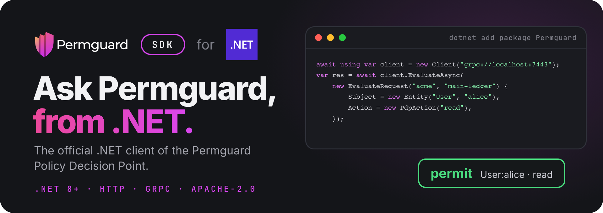

<!-- Copyright (c) 2022 Nitro Agility S.r.l. -->
<!-- SPDX-License-Identifier: Apache-2.0 -->

# Permguard .NET SDK

[](https://www.nuget.org/packages/Permguard)
[](https://github.com/permguard/sdk-netcore/actions/workflows/sdk-netcore-ci.yml)
[](https://www.apache.org/licenses/LICENSE-2.0)

<p align="center">
  
</p>

<p align="center">
  <a href="https://github.com/permguard/permguard"><b>Permguard</b></a> ·
  <a href="https://docs.permguard.com/"><b>Documentation</b></a> ·
  <a href="#install"><b>Install</b></a> ·
  <a href="#quick-start"><b>Quick start</b></a> ·
  <a href="#develop"><b>Develop</b></a>
</p>

**The official .NET client of the Permguard Policy Decision Point.**

Before your code acts, it asks Permguard whether a subject may perform an action on a resource, and Permguard answers from the policies of a ledger.
This SDK is how .NET code asks: one asynchronous client for the native, stateless PDP interface `permguard.api.pdp.native.v1`, over HTTP/JSON or gRPC, with the same request and the same answer on both.

<p align="center">
  
</p>

<p align="center"><sub>Your code asks, the SDK carries the question, the data plane decides with the ledger's policies.</sub></p>

## Install

The SDK targets .NET 8 and is published on NuGet.

```console
dotnet add package Permguard
```

It needs a Permguard data plane to ask: by default it listens on port `7443`, for HTTP and gRPC alike.
See the [Permguard repository](https://github.com/permguard/permguard) to run one.

## Quick start

```csharp
using Permguard;
using PdpAction = Permguard.Action;

// grpc:// or grpcs:// speaks gRPC; http:// or https:// speaks JSON.
await using var client = new Client("grpc://localhost:7443");

try
{
    var response = await client.EvaluateAsync(new EvaluateRequest("acme", "main-ledger")
    {
        Profile = "gateway",
        Subject = new Entity("User", "alice"),
        Resource = new Entity("Document", "budget-2026"),
        Action = new PdpAction("read"),
        RequestId = Guid.NewGuid().ToString(),
    });
    Console.WriteLine(response.Decision ? "PERMIT" : "DENY");
}
catch (Refusal refusal)
{
    Console.Error.WriteLine($"refused: class={refusal.ErrorClass} code={refusal.Code} message={refusal.Message}");
}
```

`Action` is also a name in `System`: the `PdpAction` alias keeps the two apart.
The same program is in [SampleJsonPermguard](SampleJsonPermguard/Program.cs); pass an endpoint or set `PERMGUARD_PDP_URL` to point it at another data plane.

### The request

| Property                        | What it says                                                            |
| ------------------------------- | ----------------------------------------------------------------------- |
| `EvaluateRequest(zone, ledger)` | the ledger whose policies decide, in its zone                           |
| `Profile`                       | the profile of the ledger's manifest that selects the partitions to run |
| `Subject`                       | who asks: a type and an id, with optional `Properties`                  |
| `Resource`                      | what is acted on: a type and an id, with optional `Properties`          |
| `Action`                        | what is done: a name, with optional `Properties`                        |
| `Context`                       | any other fact the policies read                                        |
| `PartitionInputs`               | runtime data for the partitions of the profile, see below               |
| `RequestId`                     | your id for the call, given back in the answer                          |

### The answer

A deny is not an exception: it is a successful `EvaluateResponse` with `Decision == false`.
Validation, authorization, availability and server failures throw `Refusal`, with their stable `ErrorClass` and `Code`, and the `HttpStatus` or `GrpcStatus` they came with.

## Partition inputs

Runtime data is addressed to the partition name the ledger's profile declares:

```csharp
var request = new EvaluateRequest("acme", "main-ledger")
{
    PartitionInputs = new Dictionary<string, PartitionInput>
    {
        ["authorization"] = new PartitionInput("permguard.cedar.entities.v1", new[]
        {
            new Dictionary<string, object?>
            {
                ["uid"] = new Dictionary<string, object?> { ["type"] = "Team", ["id"] = "engineering" },
                ["attrs"] = new Dictionary<string, object?> { ["active"] = true },
                ["parents"] = Array.Empty<object>(),
            },
        }),
    },
};
```

The key is a partition name from the selected profile.
The input type asserts the partition's input contract; it does not select a policy runtime.

## Many evaluations at once

Set the defaults on the request, list the `Evaluations`, and call `EvaluateManyAsync`:

```csharp
var response = await client.EvaluateManyAsync(new EvaluateRequest("acme", "main-ledger")
{
    Subject = new Entity("User", "alice"),
    Evaluations = new[]
    {
        new Evaluation
        {
            Resource = new Entity("Document", "budget-2026"),
            Action = new PdpAction("read"),
            RequestId = "read",
        },
        new Evaluation
        {
            Resource = new Entity("Document", "budget-2026"),
            Action = new PdpAction("update"),
            RequestId = "update",
        },
    },
    Options = new EvaluationOptions { EvaluationsSemantic = EvaluationsSemantic.ExecuteAll },
});

foreach (var result in response.Evaluations ?? [])
{
    Console.WriteLine($"{result.RequestId}: {(result.Decision ? "PERMIT" : "DENY")}");
}
```

Each evaluation inherits what it does not set from the request.

## Endpoints and options

| Endpoint   | Transport                                      |
| ---------- | ---------------------------------------------- |
| `http://`  | JSON over HTTP                                 |
| `https://` | JSON over HTTPS                                |
| `grpc://`  | `permguard.data.v1.PolicyDecisionPoint`        |
| `grpcs://` | `permguard.data.v1.PolicyDecisionPoint` on TLS |

```csharp
await using var client = new Client("https://pdp.example.com", new ClientOptions
{
    Timeout = TimeSpan.FromSeconds(5),
    Headers = new Dictionary<string, string> { ["authorization"] = $"Bearer {token}" },
});

var configuration = await client.GetConfigurationAsync();
```

| Option               | Sets                                               |
| -------------------- | -------------------------------------------------- |
| `Timeout`            | the timeout of every call, five seconds by default |
| `Headers`            | static headers, also sent as gRPC metadata         |
| `HttpClient`         | the `HttpClient` used for HTTP                     |
| `GrpcChannelOptions` | the channel options used for gRPC                  |

Every call also takes a `CancellationToken`.
`GetConfigurationAsync` reads the data plane's discovery document.

## Compatibility

This major version implements `permguard.api.pdp.native.v1`.
Compatibility is tied to that versioned interface, not to a server minor version.

## Develop

```console
dotnet restore SamplePermguard.sln
dotnet test SamplePermguard.sln --configuration Release -m:1
dotnet pack Permguard/Permguard.csproj --configuration Release
```

The NuGet package includes `LICENSE`, `NOTICE.md`, `THIRD_PARTY_NOTICES.md` and this README.

## License

Apache License 2.0: see [LICENSE](LICENSE), [NOTICE.md](NOTICE.md) and [THIRD_PARTY_NOTICES.md](THIRD_PARTY_NOTICES.md).

Permguard is a trademark of Nitro Agility S.r.l., see [TRADEMARKS.md](TRADEMARKS.md).
.NET and the .NET logo are trademarks of Microsoft Corporation, shown only to name the platform this SDK is for.
